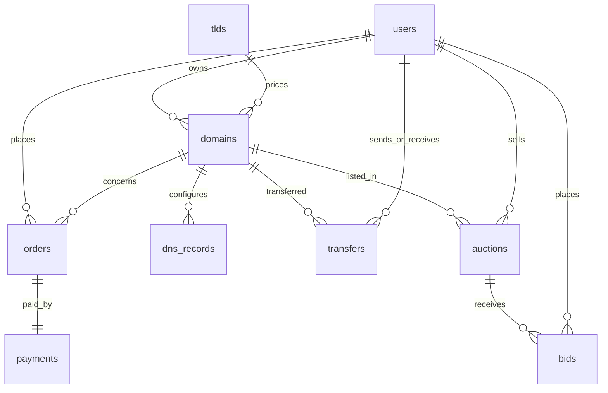

# Domain Hub

Domain Hub is a domain-management and auction demo built with React, Vite, Express, and direct SQL. Its public landing page explains the workspace and lets visitors search app records before signing up. The frontend calls the REST API; it never connects to a database. The app uses nine tables and has MySQL (local) and PostgreSQL (Neon) schema variants.

Domain search checks the application's own database and configured TLD prices; it does not query an external registrar or confirm availability across public registries. Registrations and payments are also modeled in the app rather than processed by external services.

## Prerequisites and local setup

- Node.js 20 or newer and npm.
- MySQL 8 running locally. Use MySQL Workbench to create a connection and a database account with permissions to create/use `domain_hub`.

In MySQL Workbench, connect to your local server, open `backend/sql/schema.mysql.sql`, and run the whole script. It creates and selects the `domain_hub` database and its nine tables. Then open and run `backend/sql/sample.mysql.sql` to add demo users, TLDs, domains, and an auction. Copy `backend/.env.example` to `backend/.env`, then fill in your MySQL connection values and replace `JWT_SECRET` with a random value at least 32 characters long. Copy `frontend/.env.example` to `frontend/.env`.

From the repository root:

```powershell
npm install
npm --prefix backend install
npm --prefix frontend install
npm run dev
```

The frontend is at `http://localhost:5173`; the API is at `http://localhost:4000/api`. Visitors can use the landing page at `/`, sign in at `/login`, and create an account at `/register`. To run checks, use `npm --prefix backend test` and `npm --prefix frontend run build`.

Demo logins (the sample password is `DomainHub123!`):

- Admin: `admin@domainhub.test`
- User: `asha@example.test`
- User: `ravi@example.test`

The demo password is for local coursework only. All seeded users have bcrypt password hashes. Registration always creates a regular user; role changes are not exposed by the API.

## Neon PostgreSQL deployment

1. Create a Neon project and database in the Neon console, then copy its pooled or direct connection string.
2. Run `backend/sql/schema.postgres.sql` in the Neon SQL Editor (or `psql`), then run `backend/sql/sample.postgres.sql` for the demo data.
3. Set the backend environment to `DB_CLIENT=postgres`, `NEON_DATABASE_URL` to the Neon connection string, a unique 32+ character `JWT_SECRET`, `NODE_ENV=production`, the public frontend origin in `FRONTEND_URL`, `COOKIE_SECURE=true`, and `COOKIE_SAME_SITE=none` when frontend and API are on separate sites. The pg adapter enables TLS and certificate validation is disabled for compatibility with hosted Neon endpoints.
4. Deploy the backend as a Node service with `backend` as the working directory and `npm start` as the start command. Deploy `frontend` as a static Vite site (`npm run build`, output directory `dist`). Configure `VITE_API_BASE_URL` to the deployed backend's `/api` URL, and configure the backend's `FRONTEND_URL` to the deployed frontend origin. Redeploy after setting environment variables.

For local MySQL cookies, use `COOKIE_SECURE=false` and `COOKIE_SAME_SITE=lax`. API cookies are HttpOnly. Cross-site cookies require HTTPS and `SameSite=None`.

## Business rules

- Domain status compares UTC calendar dates, with `days = expiry date - today`; expiry day itself has zero days remaining and is `EXPIRING`. `ACTIVE` is 31+ days remaining, `EXPIRING` is 0–30 days remaining, `GRACE` is 1–30 days past expiry, and `EXPIRED` is 31+ days past expiry.
- Registration reads the current TLD price and inserts domain, order, and simulated payment in one transaction. The unique `(name, extension)` key and transactional lookup protect concurrent attempts. Set `SIMULATE_PAYMENT_FAILURE=true` to force payment failure; the transaction rolls back.
- Renewal is for one year and extends from the current expiry while active, expiring, or in grace; expired domains cannot renew. Auctioned domains cannot renew or transfer. `SIMULATE_PAYMENT_FAILURE=true` also rolls back renewal and auction settlement.
- DNS and transfer operations check ownership on the server. Transfers require the receiver to be an existing account and remain pending until that account accepts/rejects.
- Auctions use row locks when bidding and settling. There is no scheduler: loading auction lists or auction endpoints processes ended auctions. A no-bid auction closes UNSOLD; successful settlement creates a purchase order/payment and changes ownership in a transaction.
- Payment is simulated; no card details or external processor are used. Prices are stored as decimal values.

## API outline

All responses use `{ "data": ... }`; errors use `{ "error": "..." }`.

| Area | Endpoints |
|---|---|
| Authentication | `POST /auth/register`, `POST /auth/login`, `POST /auth/logout`, `GET /auth/me` |
| Search and domains | `GET /search?domain=...`, `POST /domains/register`, `GET /domains`, `POST /domains/:id/renew` |
| DNS | `GET/POST /domains/:id/dns`, `PUT/DELETE /dns/:id` |
| Transfers | `GET /transfers`, `POST /domains/:id/transfers`, `POST /transfers/:id/accept` or `/reject` |
| Auctions | `GET /auctions/live`, `/bids`, `/listings`, `/won`; `POST /domains/:id/auctions`; `POST /auctions/:id/bids` |
| Orders/dashboard | `GET /orders`, `GET /dashboard` |
| Admin | `GET /admin/summary`, `GET /admin/orders`, `GET/PUT /admin/tlds` |

## Data model



Tables: `users`, `tlds`, `domains`, `orders`, `payments`, `dns_records`, `transfers`, `auctions`, and `bids`. Schema files define the same relationships and constraints in both dialects; SQL identifiers are static and user values are parameterized. The adapter owns dialect placeholder conversion, transaction connections, inserted ID handling, and PostgreSQL TLS configuration.

## Verification notes

The domain status unit tests cover all seven requested day boundaries. Backend integration tests need a reachable MySQL instance and seeded schema. In an environment without configured MySQL credentials or a Neon URL, those database scenarios and PostgreSQL runtime flows cannot be honestly reported as verified. Run the two schema/sample scripts first, set environment variables, then exercise the API. The responsive frontend includes a public marketing landing page, domain search entry point, sign-in/sign-up screens, and the authenticated management dashboard.
